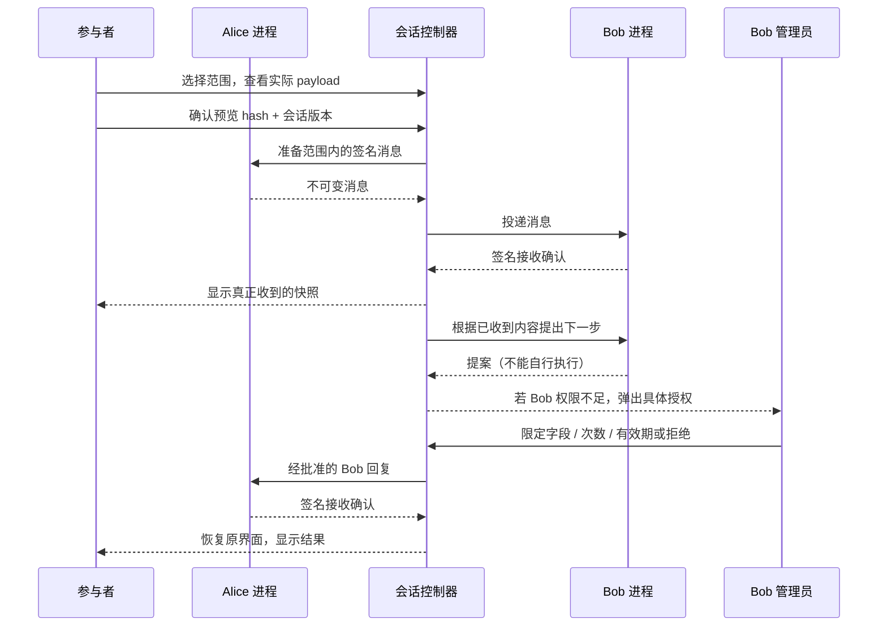
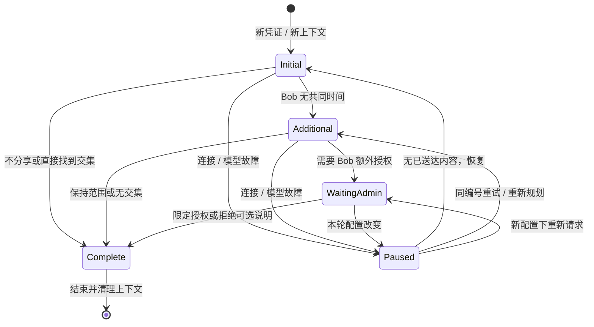
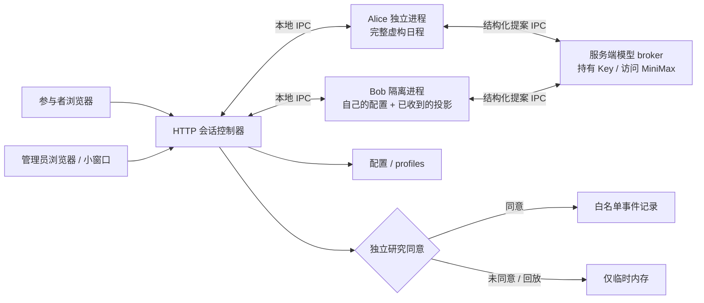

# Agent on Request

为一次研究活动准备的独立演示项目。参与者决定 Alice 向 Bob 分享什么；研究者控制 Bob 的配置、授权以及所有 Agent 的模型。默认数据全部虚构，默认研究记录关闭。Alice 和 Bob 均在本机的独立进程中运行，各有独立临时目录、上下文与权限限制。

## 运行

需要 Node.js 26 或更高版本，无生产依赖，不需要 `npm install`。旧版 Node 缺少网络权限限制时，启动会明确失败。

```sh
npm start
```

打开 [http://127.0.0.1:4317](http://127.0.0.1:4317)。终端会显示随机生成的管理员 PIN。点击 **Researcher sign in** 登录；PIN 和模型密钥不会出现在浏览器配置里。设置固定 PIN 可使用：

```sh
AGENT_DEMO_ADMIN_PIN=your-event-pin npm start
```

端口由 `PORT` 控制，默认仅监听本机；需要活动局域网访问时明确设置 `HOST=0.0.0.0`。研究者和参与者可以在不同浏览器或电脑中打开同一个服务，研究者从 Operator console 选择参与者会话。

## 一轮体验

1. 选择 **Controlled**，研究同意保持关闭或由参与者明确勾选，开始一轮。
2. 在周二、周三范围内选择空闲时间、忙闲状态、完整日程或不分享。查看精确字段和行，再发送。
3. 默认 Bob 只有周四 15:00–15:30 空闲。参与者可以保留范围、只补充周四空闲时间或分享全周日程。
4. 找到共同时间后，Bob 请求分享会议说明。点击管理员入口，登录小窗口，允许一次、选择更少字段、给予本轮有限授权或拒绝。关闭窗口保留请求，处理完返回原参与者界面。
5. 查看实际接收快照、分享边界和解释后的理解题，最后点击结束。下一轮使用新凭证、新上下文和新的研究同意选择。

管理员批准的是 Bob 的具体出站内容。管理员账户不能代替参与者提交 Alice 的分享选择。拒绝可选说明不会取消已经获得双方确认的会议。



## Bob 配置与现场恢复

Bob configuration 提供常用字段表单和完整 JSON，包括 persona、目标、提示、合成可用时间、说明、工具、接收对象、字段、资源、时间窗、次数、期限、确认方式和响应约束。未知 JSON 字段会保留；不会执行未注册工具。模型与凭据在独立的 **Model configuration** 页统一管理，旧 Bob JSON 中的 `runtime` 字段仅为兼容旧配置保留，不控制应用的 LLM。

编辑形成草稿，验证并查看差异后，选择：

- **新轮次预设**：仅影响后续创建的会话。
- **本轮覆盖**：暂停该轮、替换 Bob 配置并使旧待决授权失效。点击 Resume 重新检查；已经收到的 Alice 快照和参与者选择保留。

支持保存与加载配置 profile。Operator console 可暂停、恢复、重置、模拟 Bob 断线以及触发一项可选说明分享。恢复连接不会自动发送；重试沿用原操作编号和 payload。参与者停止分享后，尚未确认的 Alice 发送不再重试；原来已收到的副本保留。不确定的发送不会显示为收到。

每个生效的配置版本保存独立快照和 hash，可在配置页面的 Saved configuration revisions 中查看，用研究记录的 revision 复盘条件。本轮限次授权保持批准的字段和内容；过期后恢复先只读核验已收证明，缺少证明时重新请求授权。



清理失败时，系统会关闭授权与研究轮次，显示清理尚未确认，并阻止创建下一轮。恢复进程后再开始会重新核验清理。

## Agent harness 与本机隔离

Harness 是为活动自写的轻量状态机：按介绍、初次协作、补充时间、分享说明等阶段调用规划器。每次 LLM 请求只提交一个结构化提案，会话控制器检查实际接收数据、参与者选择和管理员授权后执行注册动作，并验证对端签名回执。Controlled 复用相同执行与授权链路，规划改用规则。当前没有任意代码执行或通用多轮工具循环。

两个 Worker 使用 Node 权限模式，只能读取启动所需的两个源码文件；禁止网络、文件写入、子进程、Worker threads、原生扩展和 Inspector。环境变量按白名单复制，模型 Key 和 API 地址仅在父服务端；Worker 通过有签名、绑定轮次的 IPC 请求服务端模型 broker。独立临时目录权限为 0700，进程退出时删除。该隔离适用于本项目受信任的 Worker 代码；Node 权限模式不构成抵御恶意代码的操作系统沙箱。详见 [runtime](docs/runtime.md)。



## 三种模式

**Controlled** 使用规则规划，真实进程通信、签名和授权检查正常执行，适合稳定现场体验。

**Live** 默认使用 **MiniMax 中国版 Token Plan / MiniMax-M3**。管理员登录后打开 **Model configuration**，在专用密码框输入 `sk-cp` 开头的订阅 Key，点击旁边的 **Save API key**（或按 Enter），再分别点击 Alice、Bob 的连接测试。单独保存 Key 无需先验证其他参数；参数修改仍需验证并审阅后保存。服务地址预设为 `https://api.minimax.cn/v1`。没有 Key 时 Live 不可用。也可选兼容服务用于本地测试；HTTP 仅允许回环地址，其余地址必须 HTTPS。项目不会自动换到其他计费 Key 或模型。

所有 Agent 的 model、temperature、输出上限、超时、规划重试次数及 M3 thinking 可分别编辑。新配置和 Key 从下一轮生效；当前轮使用创建时的固定快照。Key 不回传浏览器，不放研究记录或 profile；仅保存当前 `.data/models.json`（0600，目录 0700），没有凭据历史。换服务地址时须明确更换或清除原 Key。

MiniMax 请求通过 `submit_proposal` function 接收 JSON，兼容解析最终 JSON 文本；不依赖 M3 未确认支持的 `response_format`。返回的推理内容不展示、不保存。Live 会把 Alice 的虚构日程发给 Alice 的模型服务；Bob 模型只获得 Bob 自己的合成信息和 Alice 已送达的投影。界面按本轮模型版本披露服务地址。模型只能提案，不能扩展授权；无效输出、拒绝、截断、超时与错误会暂停该轮。接入细节与官方来源见 [MiniMax 配置](docs/minimax.md)。

**Replay** 是显式标记的合成参考轨迹，不产生真实消息、接收确认或研究记录。

## 研究记录

只有参与者明确同意的 Controlled / Live 轮次才持久化白名单事件。记录字段范围、选择、哈希、接收确认、理解题、配置版本和干预/故障标记；不保存原始聊天、日程行、姓名或 IP。操作编号为内部伪名，可关联同一轮。研究选择与分享授权独立。

`Research review` 显示实际记录并导出 CSV / JSONL。任务完成后仍可答题；结束或重置才关闭研究轮次。管理员等待时间单独记录。清理或故障会保留质量标记。每轮研究记录保存起始 `modelRevision` 与 Alice/Bob 的模型参数快照，后续全局修改不会改写，导出不含 Key、服务地址或推理。记录默认写入 `.data/research/runs.json`；配置写入 `.data/config.json`，均不提交 Git。每轮上下文只保留在进程内存中，会话创建两小时后清理。浏览器只在 sessionStorage 暂存该标签页的会话凭证与未确认提交，管理员 token 只放内存。

详细口径见 [研究说明](docs/research.md)、[现场操作指南](docs/operator-guide.md) 和 [接口契约](docs/api-contract.md)。理解题目前用于解释后检查，不应作为无提示条件下的授权理解基线。

## 验证

```sh
npm test
```

测试覆盖独立进程与实际权限拒绝、精确投影、签名/伪造回执、幂等冲突、模型失败、配置快照、密钥存储与脱敏、MiniMax 请求格式、管理员字段收窄、撤回、重置、研究同意和 HTTP 角色边界。历史远程适配器仍作为库级兼容夹具测试；活动应用固定使用本机 Bob，忽略 `BOB_URL`。测试用本地模拟模型服务，不调用付费外部 API。

浏览器验收脚本为 `scripts/browser-smoke.mjs`，需要可用的 Playwright / Chromium（可通过 `NODE_PATH` 或 `DEMO_PLAYWRIGHT_MODULE` 指向已有模块，属于可选 QA 依赖）。默认自动启动独立的临时内存演练服务：

```sh
ADMIN_PIN=your-event-pin node scripts/browser-smoke.mjs
```

可用 `DEMO_URL` 指定其他演练地址。脚本创建演练记录和 profile，并在 `artifacts/` 保存实际截图；显式地址应指向演练副本。`scripts/model-browser-smoke.mjs` 另验模型页、Alice/Bob 本地连接探针、写入及清除 Key、轮次快照和明暗主题下 320 / 736 / 1024 像素布局，始终使用独立内存服务。外部付费 M3 调用需要管理员填写有效订阅 Key 后实测；自动化验收使用本地 HTTP 夹具。

`scripts/interrupt-browser-smoke.mjs` 使用独立服务和挂起的本地模拟模型，验证真实界面的 End、Stop、未知结束响应的同编号核验，以及迟到响应不能恢复已结束轮次。它不会请求外部模型或修改活动服务。
