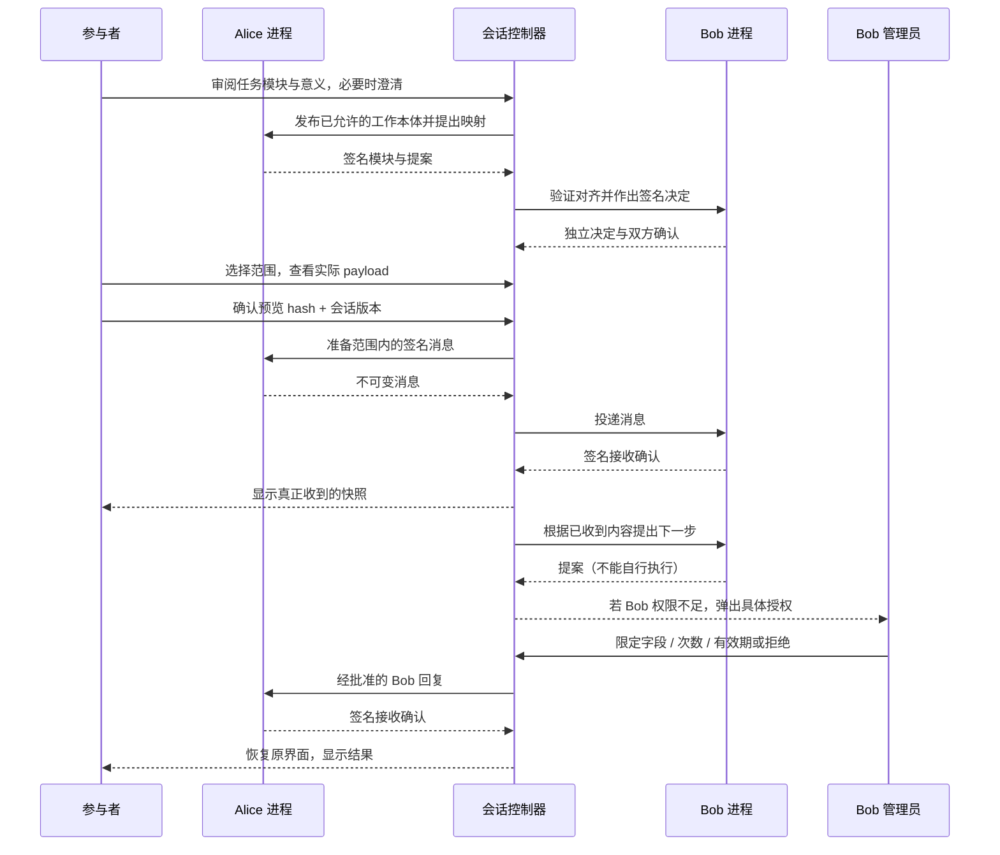
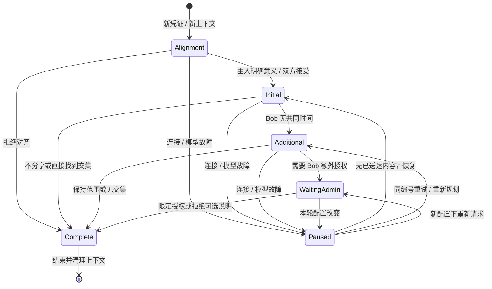
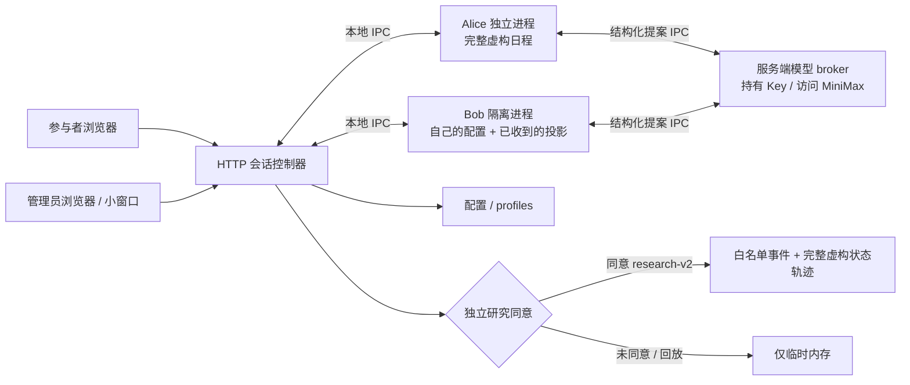

# Agent on Request

为学术会议准备的个人助理协作演示。Alice 和 Bob 有不同的概念定义与数据表示，先按任务选择本体模块、协商可执行映射，再由各自主人决定实际披露哪些信息。接收方通过已接受的映射解释真正收到的数据，并查询带回执来源的语义状态来完成安排。默认数据全部虚构，默认研究记录关闭。两个 Agent 在本机独立进程中运行，各有独立临时目录、上下文与权限限制，由受信任的中央控制器协调。

实现借鉴提供的两篇研究工作中的任务相关 working subset 和本体对话机制，采用适合现场演示的有限候选与可重现流程。条件映射、表示转换和主人澄清是 demo 的扩展；本项目没有原样复现论文实验、任意本体匹配或独立跨机器部署。机制、研究对应和实现边界见 [本体对话说明](docs/ontology-dialogue.md)。

## 运行

直接演示可运行 `npm run demo`，或在 Windows 运行 `powershell -ExecutionPolicy Bypass -File scripts/start-demo.ps1`。演示实例默认打开 [http://127.0.0.1:4327](http://127.0.0.1:4327)，全部控制入口直接可用，无需研究者登录。数据和公开配置使用独立 `.data/demo`。Windows 启动器会选择可用的 Node 26+（也支持 `AGENT_DEMO_NODE`）。[操作、用户心智与完整验收](docs/demo-acceptance.md) 包含逐项矩阵和可直接照着走的演示脚本。

启动演示会自动读取项目根目录的 `.env`，MiniMax Key 使用 `MINIMAX_TOKEN_PLAN_KEY`，无需在页面重复填写。`.env` 已被 Git 忽略；`.env.example` 只提供空值模板。已有演示的 MiniMax Key 会自动迁移到 `.env`，模型存储只保留来源标记。修改 `.env` 后重启演示生效；在页面明确清除 Key 后，重启不会重新启用它。

需要 Node.js 26 或更高版本，无生产依赖，不需要 `npm install`。旧版 Node 缺少网络权限限制时，启动会明确失败。

```sh
npm start
```

`npm start` 是可选的 PIN 活动模式，打开 [http://127.0.0.1:4317](http://127.0.0.1:4317)。终端会显示随机生成的管理员 PIN。点击 **Researcher sign in** 登录；PIN 和模型密钥不会出现在浏览器配置里。设置固定 PIN 可使用：

```sh
AGENT_DEMO_ADMIN_PIN=your-event-pin npm start
```

界面支持中文和 English。右上角的 **中文 / English** 按钮即时切换参与者、研究者控制台、配置、研究回顾和弹窗文字；打开弹窗时同一个按钮位于弹窗标题栏。首次使用跟随浏览器的中英文偏好，其他语言默认中文；选择保存在浏览器 `localStorage`，刷新后继续使用。切换不会重载页面、提交操作或修改当前会话、表单草稿与授权选择。JSON、指纹、配置差异和输入值保持原样，自定义内容与实时模型输出保留原文。

配置按三层呈现：首层用彩色卡片选择体验方式、起始套装、Bob 的目标/资料/共享边界，以及模型服务与两个 Agent 的模型；展开卡片可调整常用字段，继续展开可编辑提示词、JSON、超时重试或复用配置。初始状态先显示两张角色摘要，完整知识图谱和原始定义按需查看。折叠与展开不会应用配置；Bob 和模型修改须校验并审阅差异，起始条件须校验预览，才能分别应用或开始一轮。

精细化配置提供随草稿更新的视觉提示：Bob 的目标摘要、24 小时时间条及共享流向；模型的生成风格刻度、输出上限示意和重试流程；初始条件的星期分布、知识关系和授权限额。组件按类别选择，自定义数据按单条展开，模型每次展开一个参数组。校验失败会显露并定位错误字段；变更审阅先显示分类与修改前后，属性路径和原始 JSON 可继续展开。编辑、语言切换和导航保持公开草稿，密钥仍在离开面板时清空。

预设只是起点：套装和类别卡提供直接自定义入口，可编辑知识、时间、授权，以及新增技能名称和描述/指令。Bob 支持自定义共享字段、确认方式、完整简报和扩展元数据；模型页可连接自定义兼容 API、填写模型名称及参数。三类配置都可导入和导出，复用时先作为草稿校验。自定义技能描述用于各自智能体的规划和状态展示，执行动作仍须属于运行时注册工具并满足授权。

同样的分层贯穿参与者流程、研究者登录与审批、操作控制台和研究回顾。主流程呈现概念差异、任务模块、对齐决策、共享预览和结果。参与者默认代表 Alice 主人，只能查看自己的内部状态和实际接收的信息；研究者显式进入观察视图后，才能检查双方合成状态。初始化工作台属于实验配置和观察工具。审批优先显示 Bob 主人正在批准的真实字段与内容，技术标识和本轮限次授权可进一步展开。

端口由 `PORT` 控制，默认仅监听本机；需要活动局域网访问时明确设置 `HOST=0.0.0.0`。研究者和参与者可以在不同浏览器或电脑中打开同一个服务，研究者从 Operator console 选择参与者会话。

## 一轮体验

1. 选择初始化套装，或分别组合 Alice / Bob 的 KG、数据、skills、授权组件。可以进一步编辑自定义条件；先审阅双方的可读预览。PIN 活动模式中改变 Bob 初始条件需要研究者登录；本地演示直接提供这些观察和配置控制。
2. 选择 **Controlled / Guided**，界面任务默认 30 分钟，也可选 45、60 分钟（API 另支持 15 分钟）。选择异构表示场景或“Free 仅表示没有事件”的歧义场景；界面启动的新轮次都会先审阅模块和映射。研究同意保持关闭或由参与者明确勾选。
3. 在对齐卡中查看 Alice 的日历区间与 Bob 的数值分钟/可邀请状态。接受、请求澄清或拒绝；歧义场景必须由 Alice 主人明确决定空闲是否可用于这次邀请。对齐成功不会自动授予数据访问权。
4. 在周二、周三范围内选择空闲时间、忙闲状态、完整日程或不分享。查看精确字段和行，再发送。真正收到的信息才通过映射进入 Bob 的语义事实登记。
5. 默认 Bob 只有周四 15:00–15:30 空闲。补充请求根据当前 Bob 可用日期与实际已知数据生成；更改场景后不再固定询问周四。参与者可以保留范围、只补充请求日期的空闲时间或分享全周日程。
6. 找到共同时间后，Bob 可请求分享会议说明，使用独立的简报模块。代表 Bob 主人审阅，允许一次、收窄字段、给予本轮有限授权或拒绝。关闭窗口保留请求，拒绝可选说明不会取消已确认的安排。
7. 查看结果中的语义对齐、信息授权与实际接收证据，按需回答共享、撤回、本体对齐和任务模块理解题。首次选择确认后显示参考答案与解释，保留原答案供比较。最后点击结束，下一轮使用新凭证、新上下文和新的研究同意选择。

对齐卡回答的是“双方如何理解同一条信息”。例如 Alice 的 `Tue / 10:00–11:00` 要转换成 Bob 的星期编号和起止分钟；Alice 的“没有日历事件”还不一定等于“主人愿意接受会议邀请”。接受对应关系只解决理解方式，随后仍要单独预览并批准实际共享内容。

管理员批准的是 Bob 的具体出站内容。管理员账户不能代替参与者提交 Alice 的分享选择。拒绝可选说明不会取消已经获得双方确认的会议。

## 初始化与双方状态

初始化服务提供研究会议、最小分享、共享研究背景、逐次主人审核和从零构建套装。每个角色均有 KG、数据、skills、授权四类组件；组件替换对应类别，自定义补丁最后生效，数组整体替换。技能可使用自定义 ID，并附可选的 `skillDefinitions` 名称和描述；注册技能仍受角色限制。完全自定义须遵守合成数据、合法时间段和完整图引用等约束。默认套装与 Bob 的“当前主人模板”组件使用当前模板，因此研究者修改模板后应重新预览。

`GET /api/conditions/catalog` 返回套装、组件、skills 和限制，`GET /api/conditions/schema` 返回 JSON Schema，`POST /api/conditions/resolve` 校验并返回完整条件、hash 和双方可视化预览。创建轮次携带审阅过的 `expectedConditionsHash`；条件漂移会要求重新审阅。修改 Bob 时还需 `X-Researcher-Token`。接口格式见 [接口契约](docs/api-contract.md)。

初始化工作台支持下载及导入完整条件；研究者还可保存共享套装，并按版本加载、更新或通过接口删除。套装写入 `.data/conditions.json`，和参与者研究记录独立；同名更新必须匹配当前版本。只编辑或预览不会保存。观察型 Alice 可以预览自己范围内的快照，发送时才检查发送 skill、次数预算和到期限制。

每个 Agent 的 KG 显示自己的初始知识、自己的数据以及已经确认接收的对方快照，并为收到的节点保留操作编号、字段和接收时间来源。未发送内容、排队内容和待审核内容不会变成接收方知识。授权卡片展示字段、日期、次数预算、已使用次数、剩余次数、到期时间和待审核请求。Alice 的 skills、可分享字段、日期、次数与期限由控制器和 Worker 实际检查；Bob skills 取当前配置。Live 模型只取得自己的初始 KG 和实际收到的对方数据。

本体定义和映射登记位于会话的 `ontology`，可选简报使用 `briefOntology`，不改写原初始化条件 schema 或 hash。调度只选择时间与状态模块，标题/备注不参与对齐。语义事实保留接收操作、payload hash、映射 ID 和映射版本；Bob 的安排查询消费这些实际接收后的事实。缺少必要字段或未接受映射时，不会推断可邀请时间。



## Bob 配置与现场恢复

Bob configuration 提供常用字段表单和完整 JSON，包括 persona、目标、提示、合成可用时间、说明、工具、接收对象、字段、资源、时间窗、次数、期限、确认方式和响应约束。简报、能力描述和扩展字段有独立 JSON 编辑入口；使用内容后进入草稿，完整替换对应字段，删除的简报键不会恢复。未使用的 JSON 缓冲会锁定校验与应用。未知 JSON 字段会保留；不会执行未注册工具。确认方式可直接输入，`bounded` 允许授权范围内的限次发送，其他方式均须主人审核。模型与凭据在独立的 **Model configuration** 页统一管理，旧 Bob JSON 中的 `runtime` 字段仅为兼容旧配置保留，不控制应用的 LLM。

编辑形成草稿，验证并查看差异后，选择：

- **新轮次预设**：仅影响后续创建的会话。
- **本轮覆盖**：暂停该轮、替换 Bob 配置并使旧待决授权失效。点击 Resume 重新检查；已经收到的 Alice 快照和参与者选择保留。

支持保存与加载配置 profile，也可下载已校验的 Bob 配置及导入为草稿。模型页的公开配置 JSON 支持文件或粘贴导入和草稿导出，不含 API Key；连接自定义服务后再切回预设，未保存的自定义地址仍会保留。Operator console 可暂停、恢复、重置、模拟 Bob 断线以及触发一项可选说明分享。恢复连接不会自动发送；重试沿用原操作编号和 payload。参与者停止分享后，尚未确认的 Alice 发送不再重试；原来已收到的副本保留。不确定的发送不会显示为收到。

每个生效的配置版本保存独立快照和 hash，可在配置页面的 Saved configuration revisions 中查看，用研究记录的 revision 复盘条件。本轮限次授权保持批准的字段和内容；过期后恢复先只读核验已收证明，缺少证明时重新请求授权。



清理失败时，系统会关闭授权与研究轮次，显示清理尚未确认，并阻止创建下一轮。恢复进程后再开始会重新核验清理。

## Agent harness 与本机隔离

Harness 是为活动自写的轻量状态机：按本体协商、介绍、初次协作、补充时间、分享说明等阶段调用规划器。双方通过真实签名消息交换任务模块、提案、决定和确认。本体协议绑定会话、epoch、轮次版本、顺序与前序 hash；数据交换另行检查准确投影和授权。每次 LLM 请求只提交一个结构化提案；模型不会执行代码或自行扩大授权。Controlled / Guided 使用相同协议与执行链路，规划改用规则。

两个 Worker 使用 Node 权限模式，只能读取启动所需的精确源码白名单（Worker、runtime helpers 和本体引擎）；禁止网络、文件写入、子进程、Worker threads、原生扩展和 Inspector。环境变量按白名单复制，模型 Key 和 API 地址仅在父服务端；Worker 通过有签名、绑定轮次的 IPC 请求服务端模型 broker。独立临时目录在 POSIX 使用 0700，Windows 沿用父目录的 ACL，进程退出时删除。该隔离适用于本项目受信任的 Worker 代码；Node 权限模式不构成抵御恶意代码的操作系统沙箱。详见 [runtime](docs/runtime.md)。



## 三种模式

**Controlled / Guided** 使用规则规划，真实本体对话、进程通信、签名、映射转换和授权检查正常执行，适合稳定现场体验。后端模式 ID 保持 `controlled`。

**Live** 默认使用 **MiniMax 中国版 Token Plan / MiniMax-M3**。管理员登录后打开 **Model configuration**，在专用密码框输入 `sk-cp` 开头的订阅 Key，点击旁边的 **Save API key**（或按 Enter），再分别点击 Alice、Bob 的连接测试。单独保存 Key 无需先验证其他参数；参数修改仍需验证并审阅后保存。服务地址预设为 `https://api.minimax.cn/v1`。没有 Key 时 Live 不可用。也可选兼容服务用于本地测试；HTTP 仅允许回环地址，其余地址必须 HTTPS。项目不会自动换到其他计费 Key 或模型。

所有 Agent 的 model、temperature、输出上限、超时、规划重试次数及 M3 thinking 可分别编辑。新配置和 Key 从下一轮生效；当前轮使用创建时的固定快照。Key 不回传浏览器，不放研究记录或 profile；仅保存当前 `.data/models.json`（POSIX 文件 0600、目录 0700，Windows 沿用父目录 ACL），没有凭据历史。换服务地址时须明确更换或清除原 Key。

MiniMax 请求通过 `submit_proposal` function 接收 JSON，兼容解析最终 JSON 文本；不依赖 M3 未确认支持的 `response_format`。返回的推理内容不展示、不保存。Live 会把 Alice 的虚构日程发给 Alice 的模型服务；Bob 模型只获得 Bob 自己的合成信息和 Alice 已送达的投影。界面按本轮模型版本披露服务地址。模型只能提案，不能扩展授权。提案的格式或内容未通过校验时，可在该角色的重试预算内重新生成；预算耗尽后显示失败步骤与安全原因，并暂停等待处理。接入细节与官方来源见 [MiniMax 配置](docs/minimax.md)。

界面启动 Live 后会先进入对齐审阅：Alice 从有定义和转换约束的候选映射选择或拒绝，Bob 独立审阅并作出决定；模型不能提供任意转换代码。输出受任务范围、候选 ID 和状态校验约束。仅兼容 API 调用省略 `alignmentReview` 时，无歧义启动可使用已知 Guided 映射，后续安排仍可使用 Live 模型。明确拒绝可以结束为有效研究结果；无效输出和技术错误不会被悄悄替换成规则规划成功。

新模型配置默认 `retryLimit: 1`，即每次规划最多调用两次。格式错误、漏选必要映射、超出真实共享时间的提案，以及网络失败或超时共用这一个预算，不各自增加次数。保存过的 `0` 仍只调用一次。纠错请求只附固定校验指导，保留原任务与可用来源，不把失败输出或原始服务错误送回模型。本体对齐输出中可识别的 `reject` 或 `none` 会立即成为拒绝；即使说明缺失、为空、超长，或夹带多余字段和错误 ID，也只保留安全拒绝说明并清空所选映射，不会要求模型重新生成而变成接受。接受提案仍须通过完整校验。恢复失败轮次时，已确认收到的快照与来源仍保留；再次提案或送达仍要通过原有字段、内容和授权检查。切换 Guided 需要明确开始新的轮次。

会议已确认后，如果失败的是 Bob 的可选简报规划或简报本体对齐，恢复卡片会提供“保留会议，跳过可选简报”。参与者可直接保留已确认的时间，以 `arranged` 完成本轮；此操作不再调用模型、不再发送简报，也不消耗新的授权次数。它只适用于已确认会议后的这两个可选步骤，不会把尚未确认的会议或其他待送达数据变成成功。

**Replay** 是显式标记的合成参考轨迹，不产生真实消息、接收确认或研究记录。

## 研究记录

只有参与者明确同意的 Controlled / Live 轮次才持久化研究记录。新轮次使用 `research-v2`：除字段范围、选择、哈希、接收确认、理解题、配置版本和干预/故障事件外，还记录初始化条件以及每一步的完整虚构状态，包括各自 KG、模拟日历和简报、skills、授权、精确已收到快照、待审核请求和限次授权。凭证、模型密钥、原始聊天、提示和推理内容不进入状态轨迹。旧 `research-v1` 记录继续采用原来的元数据白名单，不补录日历或简报值。记录包含内部轮次和操作编号，用于关联过程，并非完全匿名。研究选择与分享授权独立。

`Research review` 显示实际记录，并可逐步回看新版记录的双方状态；CSV / JSONL 导出包含同一状态轨迹，完整复盘优先使用 JSONL。快照固定记录时刻并组成 hash 链，重载会重新脱敏、构建可视化和核验链。任务完成后仍可答题；结束或重置才关闭研究轮次。管理员等待时间单独记录。清理或故障会保留质量标记。每轮研究记录保存起始 `modelRevision` 与 Alice/Bob 的模型参数快照，后续全局修改不会改写，导出不含 Key、服务地址或推理。记录默认写入 `.data/research/runs.json`；配置写入 `.data/config.json`，均不提交 Git。执行上下文只保留在进程内存中，会话创建两小时后清理；研究轨迹用于回顾，不能恢复已结束或重启前的运行会话。浏览器只在 sessionStorage 暂存该标签页的会话凭证与未确认提交，管理员 token 只放内存。

新版合成状态轨迹还保存经过白名单与 hash 校验的本体模块、提案/决定、accepted 映射、实际接收的语义事实和有限签名协议证据。新增理解题区分“对齐帮助解释”与“对齐授予权限”，并检查任务相关模块选择。记录仍只在独立研究同意开启时持久化。

详细口径见 [研究说明](docs/research.md)、[现场操作指南](docs/operator-guide.md)、[接口契约](docs/api-contract.md) 和 [本体机制](docs/ontology-dialogue.md)。理解题目前用于解释后检查，不应作为无提示条件下的授权理解基线。

## 验证

```sh
npm test
```

测试覆盖独立进程与实际权限拒绝、初始化套装与组合校验、KG 来源隔离、skills 与授权预算、精确投影、签名/伪造回执、幂等冲突、模型失败、配置快照、密钥存储与脱敏、MiniMax 请求格式、管理员字段收窄、撤回、重置、研究同意、完整状态轨迹重载和 HTTP 角色边界。历史远程适配器仍作为库级兼容夹具测试；活动应用固定使用本机 Bob，忽略 `BOB_URL`。测试用本地模拟模型服务，不调用付费外部 API。

浏览器验收脚本为 `scripts/browser-smoke.mjs`，需要可用的 Playwright / Chromium（可通过 `NODE_PATH` 或 `DEMO_PLAYWRIGHT_MODULE` 指向已有模块，属于可选 QA 依赖）。默认自动启动独立的临时内存演练服务：

```sh
ADMIN_PIN=your-event-pin node scripts/browser-smoke.mjs
```

可用 `DEMO_URL` 指定其他演练地址。脚本创建演练记录和 profile，并在 `artifacts/` 保存实际截图；显式地址应指向演练副本。`scripts/model-browser-smoke.mjs` 另验模型页、Alice/Bob 本地连接探针、写入及清除 Key、轮次快照和明暗主题下 320 / 736 / 1024 像素布局，始终使用独立内存服务。外部付费 M3 调用需要管理员填写有效订阅 Key 后实测；自动化验收使用本地 HTTP 夹具。

`scripts/interrupt-browser-smoke.mjs` 使用独立服务和挂起的本地模拟模型，验证真实界面的 End、Stop、未知结束响应的同编号核验，以及迟到响应不能恢复已结束轮次。它不会请求外部模型或修改活动服务。

`scripts/conditions-browser-smoke.mjs` 使用独立内存服务验证套装、组件、完整自定义、共享套装版本冲突、实际接收后 KG 来源、研究时间轴与观察型权限。截图和报告写入 `artifacts/conditions-browser/`。这些浏览器脚本均可设置 `DEMO_BROWSER_EXECUTABLE` 指向已有 Chrome / Chromium；不要求额外安装浏览器。

`scripts/language-browser-smoke.mjs` 使用独立内存服务验证浏览器语言偏好、按钮切换与刷新记忆、弹窗、未提交模型/密钥/JSON 草稿、日历选项协议值、完整分享及授权流程、研究回顾，以及中英文下 320 / 736 / 1280 像素布局。截图和报告写入 `artifacts/language-browser/`，同样支持上述 Playwright 和浏览器路径环境变量。

`scripts/experience-browser-smoke.mjs` 验证主流程的信息优先级、内部分类与展开状态、理解题首答记录及反馈时机、失败重试与未知提交的刷新核验，并检查小屏幕和明暗主题。`scripts/operator-browser-smoke.mjs` 验证精确审批内容、字段收窄、审批草稿恢复和控制台主要操作。两者均使用独立内存服务与虚构数据，不调用外部模型。

`scripts/refinement-browser-smoke.mjs` 验证配置的实时视觉摘要、参数组与单条数据的渐进展开、输入焦点、校验审阅与草稿失效，以及中英文和明暗主题下 320 / 736 / 1280 像素布局。截图与报告写入 `artifacts/refinement-browser/`，使用独立内存服务，不调用外部模型。

`scripts/custom-config-browser-smoke.mjs` 验证三类自定义配置的编辑、JSON 缓冲、校验、导入导出与复用，以及实际新轮次的角色技能隔离。还检查自定义服务地址的预设切换、模型配置拒绝密钥字段、中文和明暗主题下 320 / 736 / 1280 像素布局。截图与报告写入 `artifacts/custom-config-browser/`，使用独立内存服务，不调用外部模型。
