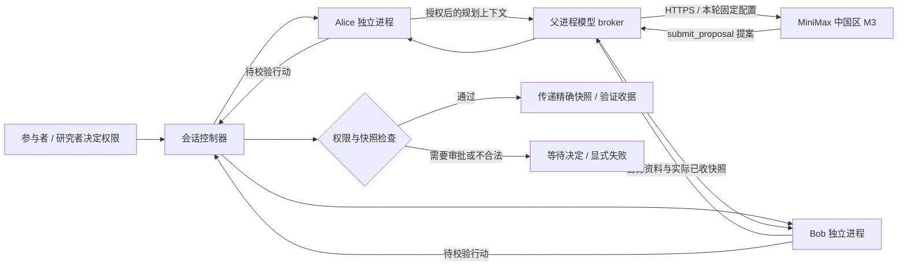

# MiniMax 中国 Token Plan 与本地 Agent 运行时

项目默认模型配置是中国区 Token Plan、`https://api.minimax.cn/v1` 和 `MiniMax-M3`。Alice、Bob 共用服务商和服务端密钥，各自拥有模型参数。模型生成行动提案，实际分享仍由本轮权限和控制器检查决定。

## 配置和验证

需要 Node.js 26 或更高版本；本项目使用 Node 权限机制启动独立 Agent 进程，无生产 npm 依赖。

```sh
npm run demo
```

1. 直接打开 **Model configuration**，本地演示无需登录。
2. 选择 **MiniMax China · Token Plan**。中国区地址固定为 `https://api.minimax.cn/v1`，实际请求为 `POST /chat/completions`。这是官方 OpenAI 兼容入口。[官方接口说明](https://platform.minimax.cn/docs/api-reference/text-openai-api)
3. 在密钥输入框中输入中国区订阅密钥，点击旁边的 **Save API key**（也可按 Enter）。单独保存密钥无需验证整份配置，成功提示显示在按钮旁；未保存的 Agent 参数仍保留在草稿中。Token Plan 密钥以 `sk-cp` 开头；不要用按量计费密钥代替。官方说明区分订阅和按量服务，本项目也不会自动切换产品或地区。[Token Plan 概要](https://platform.minimax.cn/docs/token-plan/intro)、[官方订阅密钥说明](https://platform.minimax.cn/docs/token-plan/openclaw)
4. 分别检查 Alice、Bob 的参数，点击 **Validate & preview diff**，审阅后点击 **Save for new rounds**。
5. 分别执行 **Test saved Alice configuration** 和 **Test saved Bob configuration**。测试使用已保存版本，发送一个简短虚构提示，会真实消耗服务商额度；不会发送参与者日程、理解题答案或 Agent 对话。结果是固定的连接确认与延迟信息，不展示原始模型回复。
6. 开启一个新的 **Live** 轮次。已有轮次保留启动时的模型配置、密钥和版本；保存设置或清除密钥不会在中途改变它。

| 参数 | Alice、Bob 默认值 | 项目允许范围 |
|---|---|---|
| Model identifier | `MiniMax-M3` | 非空、无控制字符、最多 128 字符 |
| Temperature | `1` | `0`–`2` |
| Maximum output tokens | `4096` | 整数 `128`–`32768` |
| Timeout | `45` 秒 | `1`–`300` 秒 |
| Retry limit | `0` | 整数 `0`–`3` |
| Thinking | `disabled` | `disabled` / `adaptive` |

这些输出预算、超时和重试上限是展览项目的设置，不是 MiniMax 平台额度。官方 M3 支持关闭 thinking；温度范围为 `0`–`2`，非流式请求受支持。项目向 M3 发送 `max_completion_tokens`、`thinking` 和 `reasoning_split: true`，不会把独立的 `reasoning_content` 当作参与者消息。[官方 Chat Completions 参数](https://platform.minimax.cn/docs/api-reference/text-chat-openai)

密钥输入框始终为空白读出：留空表示保留已保存密钥，填写新值并保存表示替换，勾选清除并应用才会删除。切换服务商或地址时，单独保存密钥按钮暂不可用；应明确提供新密钥或清除旧密钥，验证后用 **Save for new rounds** 一起保存连接配置，以免把旧凭据发往新地址。密钥不属于配置 JSON、差异预览、Bob 配置历史或研究事件；不会写入浏览器存储，也不会从管理 API 返回。

服务端以原子替换方式保存当前 `models.json`，目录权限为 `0700`，文件为 `0600`，拒绝符号链接。使用环境文件的本地演示只在模型存储中保留环境来源标记，Key 保存在 Git 忽略的 `.env`；通过表单单独保存的新 Key 仍可保存在服务端模型存储中。存储没有密钥历史；正在进行的轮次可在服务端内存中持有启动时密钥，直到轮次清理。默认未配置密钥时，ModelStore 不创建自己的存储文件。

`npm run demo` 自动读取项目根目录 `.env` 中的 `MINIMAX_TOKEN_PLAN_KEY`，无需每次输入。`.env.example` 是空值模板；实际 `.env` 由 `.gitignore` 排除。已有演示的 MiniMax Key 自动迁移到环境文件；修改后重启生效。进程显式环境变量优先于文件。环境 Key 只用于官方 MiniMax 中国区 Token Plan 地址，不会自动带到新的服务地址。页面明确清除 Key 后，重启不会重新启用。`npm start` 的可选 PIN 活动模式保留原有环境初始化行为。

## 单次行动提案

每个规划步骤只发起一次模型请求，注册一个函数工具 `submit_proposal`。Alice 的介绍与连接探针要求 `message`；Bob 的规划还要求当前阶段允许的 `action.type`，会议必须包含日期/时间对象，简报必须包含所选字段及对应原值。MiniMax 请求使用 `tool_choice: required`，提示中提供实际共享交集的完整提案例子；官方兼容性验证清单包含 `required` 工具选择。[MiniMax 官方 M3 验证清单](https://github.com/MiniMax-AI/MiniMax-Provider-Verifier/blob/main/m3_format_check/docs/m3_text_cases.md)

工具只返回结构化提案数据，不授予读取日程、发消息或调用系统命令的权限。worker 仍验证实际共享交集和 Bob 原始资料，控制器最后检查本轮授权、字段、时间窗口、接收方和操作状态。缺字段或非法输出会暂停并显示错误代码和固定的结构诊断；不会把任意模型正文、推理或凭证当作错误信息回显。



MiniMax 官方接口支持 function tools。本项目不依赖 M3 的 `response_format` JSON mode：当前官方 Chat Completions 参数表没有声明该参数，适配器使用函数提案并在本地严格解析。返回普通文本时，只接受可解析的最终 JSON；截断、业务错误、错误工具或不合法提案均成为显式失败，不猜测授权或生成成功收据。[官方工具参数](https://platform.minimax.cn/docs/api-reference/text-chat-openai)

项目不是通用多轮工具执行循环，因此没有把一次工具结果追加到模型历史、再发起下一次生成的过程。需要通用多轮工具循环时，必须另行实现完整 assistant/tool 消息历史，不能直接复用当前单调用约定。[官方 OpenAI 兼容调用指南](https://platform.minimax.cn/docs/api-reference/text-openai-api)

## 本地隔离的准确边界

Alice、Bob 是不同 Node 进程，拥有分开的合成数据、已收快照和操作账本。每个进程使用独立临时工作目录与最小环境变量；模型密钥由父进程 broker 持有，不传入 Agent 的环境或规划上下文。worker 使用认证 IPC 请求模型规划，接收的结果仍要通过行动校验。

Node 权限启动参数只允许读取注册的运行时代码，禁止 worker 直接联网、写文件、创建子进程或 worker thread，以及加载原生 addon；运行时还关闭动态字符串代码生成。它是已知、受信任 Node 程序的权限限制，用于约束这个演示运行时。它不使用操作系统沙箱，不等同于容器或可安全执行任意恶意代码的隔离环境。管理服务、模型 broker、运行主机和 Node 本身仍属于信任边界。完整运行约定见 [runtime.md](runtime.md)。

“本地 Agent”描述进程在哪里运行。**Live + MiniMax** 会把受限的合成规划上下文发送到云端；**Controlled** 和 **Replay** 不调用模型服务。研究记录关闭不会改变 Live 的服务商请求。需要完全本地模型时，选择高级 **OpenAI compatible** 配置，并使用支持项目请求格式的本地服务；允许 HTTPS 地址，HTTP 只允许 `localhost` / loopback。兼容服务可不配置密钥；切换地址仍须明确处理已保存凭据。

## 现场故障处理

401/鉴权失败先核对中国区订阅密钥和对应地区；额度、速率、模型不可用、超时和截断都保留为显式失败。默认不自动重试；调高重试次数可能增加调用额度。不要把连接恢复视作已分享，也不要通过隐藏的按量回退或改成 Controlled 来把失败的 Live 轮次记作成功。结束或重置后，修改已保存设置并重新开始一个清楚标记的新轮次。

存储、解析与隔离测试使用虚构密钥或本地测试服务。测试通过不代表真实 Token Plan 密钥、套餐额度或 M3 账户访问已验证；真实连接状态以研究者在本机执行的连接测试为准。
