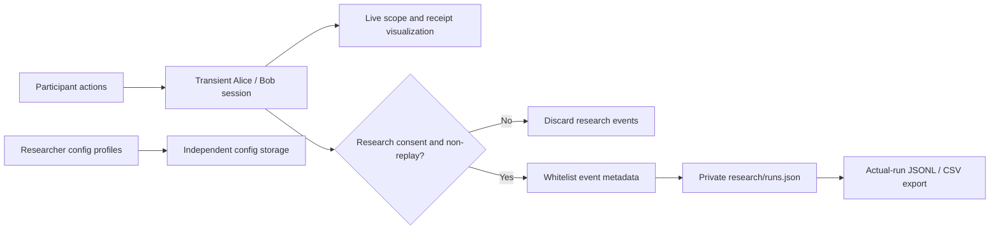

# Research recording and interpretation

This is an exploratory exhibition experience. The fictional calendar and Bob's responses are demonstration materials; the participant's decisions are real behavior. Product feedback and possible paper use must be described in the participant information and research consent text before collection. The short on-screen consent control is an implementation gate, not a substitute for that information.

## Consent is independent of sharing permission

A participant can experience the complete flow without research collection. Declining research does not disable the demonstration. Alice's decision to share a calendar snapshot is separate from consent to record choices. Bob's researcher's approval is also separate: it authorizes only a scoped Bob action and cannot create an Alice grant.

The store accepts records only when `researchConsent === true` and the mode is `controlled` or `live`. Replay never creates a research run, even when a replay request contains a true consent flag. A non-consented session receives no research run ID and contributes no identifiable replay history or behavioral counter. Session state and transport routing identifiers remain transient runtime state. Replacement and reset evict the previous session; reset starts with consent off. Browser refresh restores the same temporary session through the participant token in sessionStorage, keeping its epoch, server-confirmed choices and receipts. A draft radio selection does not recreate an authorization, and refresh does not start a second research run.

Do not add browser analytics, action-bearing access logs, request body logs, localStorage calendars or dialogue traces. Application requests have no body/access logging. The project does not save non-consented participant operation traces. Any optional external model's retention and traffic disclosure must be checked separately; the recording gate is a guarantee about this project's research files. For a strictly local experience use controlled mode and the local Bob process.

## Four-minute baseline script

Participant information and research consent are completed before timing the interaction.

| Approximate time | Activity | Neutral facilitator wording |
|---|---|---|
| 0:00–0:25 | Become fictional Alice and arrange a 30-minute discussion | “You decide what Alice shares. There is no correct sharing choice; you may decline or stop.” |
| 0:25–1:25 | Inspect a Tue–Wed snapshot: free slots, busy/free summary, full content or no sharing | “Preview the exact information before deciding.” |
| 1:25–2:15 | Baseline Bob has no availability in that window and asks for more | “You can keep the boundary, add only Thursday free slots, or provide the full-week snapshot.” |
| 2:15–2:55 | Inspect the actual receipt and optionally answer the scope understanding question | “Which information can Bob see?” |
| 2:55–3:40 | Withdraw future sharing and optionally answer the effect question | “What happens to information already received?” |
| 3:40–4:15 | Show future sharing blocked and existing snapshots still visible | “Which step was unclear?” Optional verbal feedback is not silently recorded. |

The default Thursday fixture provides a common slot. Sharing the full week and adding Thursday free slots can both support arrangement. Keeping the boundary and refusing the first request are valid terminal outcomes. The baseline intentionally makes a smaller additional disclosure sufficient; it does not establish people's general preferences about real private calendars.

Researcher changes to Bob can produce other valid scenarios, including an initial Tue–Wed match. These changes are supported and must be interpreted by their configuration revision. Do not pretend every modified round followed the baseline expansion script. Neither a sent message nor a queued operation is proof of receipt; use the authenticated received snapshot.

Question identifiers and answers:

| Question | Answer IDs | Prototype answer |
|---|---|---|
| `received_scope` | `approved_snapshot`, `outside_scope`, `not_sure` | `approved_snapshot` |
| `withdrawal` | `future_only`, `delete_received`, `not_sure` | `future_only` |

The shipped MVP displays receipt and explanatory information before the optional understanding questions. These answers are post-display checks, not blinded predictions or evidence of before/after learning. The instrumentation kind remains `prediction` for compatibility. If withdrawal is an assigned teaching step, do not analyze the click as spontaneous willingness to revoke. This prototype blocks subsequent sharing while already delivered snapshots remain visible. A fresh-round reset clears the complete demonstration state and is a different operation.

## Stored fields

Each run stores a random `runId`, mode, scenario and consent versions, start/end times, starting config revision, model revision and non-sensitive model condition, terminal status, quality flags and events. Participant tokens and admin credentials are excluded. There is no separate session-ID column, but protocol operation identifiers can contain an internal session UUID; these are pseudonymous correlation metadata, not a claim of complete anonymity. `list()` and exports contain actual consented records only; an empty collection has no illustrative data.

`modelRevision` and `models` are captured from the actual round snapshot when collection starts. `models` contains only its `revision`, `provider` and Alice/Bob settings: `model`, `temperature`, `maxTokens`, `timeoutSeconds`, `retryLimit` and `thinking`. It excludes API base URLs, keys, provider disclosure text and reasoning. Later global model changes or event payloads cannot overwrite the starting condition. Older records without model metadata keep `null`; invalid or incomplete model settings also remain missing, rather than being replaced with the current global configuration. Loading reapplies the whitelist and atomically scrubs rejected fields from persisted records. JSONL includes this snapshot; CSV includes `modelRevision` and a quoted JSON `models` column on each event row.

Events are flattened objects with sequence number, relative `elapsedMs`, kind and a small metadata whitelist. Canonical kinds include `choice`, `request`, `delivery`, `prediction`, `permission_changed`, `technical`, `admin_intervention`, `config_changed`, `stage` and `finished`. Other stable instrumentation kind IDs are accepted, but the same field filter applies. Earlier kind aliases are normalized.

Allowed metadata includes stage, enumerated choice and answer, question ID, field identifiers, known time windows, operation/payload identifiers, actor/recipient, configuration/policy revisions, technical code or identifier reason, and separately supplied `decisionMs`/`adminWaitMs`. Optional booleans describe correctness, assistance, repetition, group participation and mode switching. Unknown keys, raw messages, rows, brief values, names, IP addresses and free-text reasons are dropped. A free-text feedback facility is not part of this whitelist.

Persistence uses atomic replacement of `runs.json`; the directory is mode `0700` and files `0600`. Symlinked stores are rejected. JSONL exports contain one run per line. CSV has one row per event, with a metadata-only row for a run with no events. CSV cells are quoted and formula-like values neutralized. `ResearchStore.deleteRun()` supports deliberate removal by a trusted server caller. There is currently no deletion button or HTTP deletion endpoint; calling the library is an operator maintenance action, not an authorization mechanism.

Configuration profile storage is independent of research recording. Profiles can persist while participant research consent is off. Every applied template or temporary session configuration also enters the durable configuration-version archive with a revision, deterministic hash, target, creation time and complete synthetic configuration. The archive contains no participant session ID or behavior. Authenticated administrators can inspect it read-only through `GET /api/admin/config/versions`; the research run/event's revision links to its actual condition snapshot after reset or restart. Config validation accepts legal synthetic Bob times and unknown ordinary JSON keys; it rejects credential keys, prototype pollution keys, cyclic/non-JSON input and invalid known schema. Do not put real data or credentials in profiles or archived configs. Model credentials are held by the server in its separate current model store; peer secrets use server environment variables. Neither belongs to the configuration archive or research export. See [minimax.md](minimax.md) for model credential handling.

## Analysis checklist

- Describe initial choices and additional choices separately. Only rounds actually shown an additional request enter that stage's denominator.
- Record time windows and fields separately. Do not reduce them to a single “full sharing” score.
- `arranged`, `boundary_kept` and `declined` are complete outcomes. Refusal is not a failure. `ended` is a stopped round; technical aborts remain distinguishable.
- Reaching the task's complete stage keeps the research run open for optional understanding answers and withdrawal. `summary.taskCompleted` counts rounds which reached a recorded task outcome; `summary.runsPendingClose` counts those still active. `summary.completed` counts completed rounds only after the run is closed by End, Reset, replacement or expiry. A task outcome event does not close the record. Once closed, further answers cannot append.
- After a persistent server restart, open records cannot reconnect to an evicted controller session. They are atomically marked `incomplete` with `process_interrupted`; existing task-outcome events remain intact. No fabricated participant action or unknown end time is added, and these records no longer appear as awaiting End.
- Analyze controlled and live modes separately. Compare Live model conditions using each run's stored model snapshot and revision, rather than the researcher's currently displayed global settings. Controlled model settings describe the configured condition and are not evidence that a provider was called. Replay has no research records. Model or peer failures, recovery and substantive facilitator help should be marked; valid decisions completed before a fault can be analyzed at their stage.
- Separate changes made after explanations from initial decisions. They do not erase already received snapshots.
- Separate participant decision time from admin waiting time. A researcher waiting to approve Bob's brief is not participant hesitation.
- The terminal `technical` summary counts technical completion statuses. A technical issue which recovered can instead appear in a completed run's quality flags; that run is not counted as a technical abort.
- `summary.affectedByTechnical` counts actual recorded runs with a `technical` event or the `technical_issue` quality flag, including recovered faults. It is distinct from terminal technical aborts. CSV includes the understanding `correct` boolean and related event metadata; correctness is an explanation-after-display check, not a privacy-preference score.
- Separate rehearsal, repeats, group decisions, injected requests and changed configurations. Missing answers are missing values, never incorrect answers or refusals.
- Use standard neutral wording and equal button weight. Avoid making “full” the default or making refusal look like an error. The MVP has one baseline scenario per participant, not a multi-condition causal experiment.

`replayExcluded` is zero in the recorded-run summary because excluded replay sessions never become research records; it is not a replay attendance counter.
