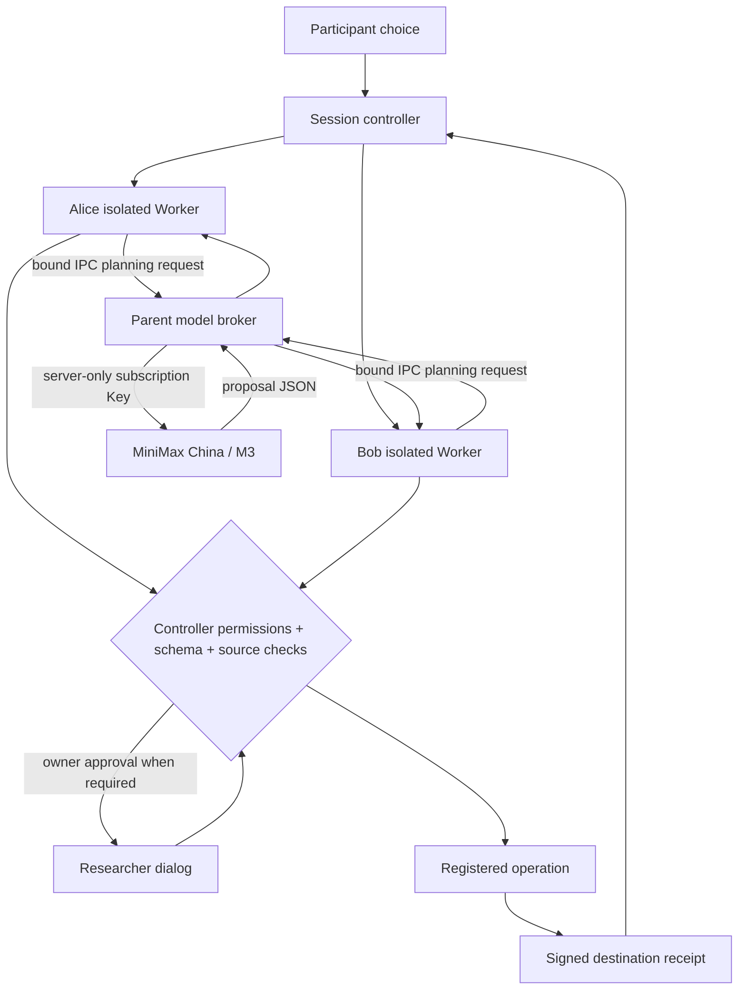

# Local Alice and Bob runtime

Node.js 26 or newer is required. `npm start` always creates two local child processes; neither the event app nor its default configuration selects a remote Bob. Each Agent owns independent in-memory contexts, received projections, outgoing ledgers, an ephemeral signing identity and a private temporary working directory. POSIX directories use mode 0700; Windows access follows the parent directory's ACL. The directory is removed on process exit.

## Isolation boundary

Workers start with Node's permission model and exact read allowlists for `agent-worker.mjs` and `runtime-helpers.mjs`. They have no filesystem write, network, child-process, worker-thread, native-addon or Inspector permissions. String code generation, experimental SQLite/FFI and global module search are disabled. Only a small platform/locale environment whitelist and Agent-specific IPC credentials are passed; provider keys and endpoint URLs are never passed to Workers. Missing network permission support fails startup explicitly.

These controls restrict the trusted, fixed Worker implementation. They are not an OS container or a hostile-code sandbox: [Node's permission documentation](https://nodejs.org/api/permissions.html) explicitly limits that guarantee. The harness does not run model-produced code or arbitrary user tools.

Alice receives her own initialized KG, fictional calendar, skills and authorization profile. Bob receives his own initialized KG, profile and synthetic configuration. Neither receives the other's initial private profile. Alice rows enter Bob's context through an exact authorized projection and confirmed delivery. Both Agents use real local IPC and separate processes in Controlled and Live modes.

## Purpose-built harness

The harness consists of the session controller, isolated Agent planners, typed proposals, registered operations, permission gates and receipt checks. It is a bounded event workflow. Each planning stage makes one model request (plus its configured retry budget), obtains one structured proposal, and returns to the controller. The `submit_proposal` function describes proposal data; calling it does not execute an operation. No tool-results continuation history is needed by this single-call design.

Every Agent has an ephemeral Ed25519 identity. The source signs the exact outgoing operation; the receiver verifies the paired identity and signs its immutable receipt. The manager checks the session, epoch, roles, operation ID, payload hash and payload digest. Controller/Worker RPC and model request/response/cancel envelopes are HMAC authenticated; model envelopes also bind request ID and model revision. The parent accepts the role assigned to its Worker connection, never a role selected by a model payload.

## Model broker and fixed rounds

The administrator configures both Agents from Model configuration. The default is China Token Plan with `MiniMax-M3`, using the subscription Key entered there. Only the parent service performs provider HTTP requests. Each round captures the current provider, model revision, per-role settings and Key in parent memory; Workers receive only sanitized availability, model name, timeout and role settings. Saving global models does not mutate existing rounds or cancel their planning. A new round captures the new revision.

The model broker makes exactly one attempt per request. A Worker controls its timeout and retry budget, avoiding duplicate retry loops. Abort, clear, policy change and process shutdown cancel pending broker work and discard late responses. Policy changes invalidate Bob's in-flight planning while preserving his immutable previously received snapshots. Provider keys are sent only as authorization headers; redirects are rejected. Errors do not copy provider bodies or network exception text into the UI.

MiniMax uses function proposals, `max_completion_tokens`, optional M3 `thinking`, and separated reasoning. The parser accepts a single registered function call or final JSON, rejects truncated/refused/invalid outputs and drops reasoning. The advanced compatible-provider option retains JSON-object mode for test services. See [MiniMax integration](minimax.md) for the exact defaults and official sources.

Initial/additional Bob planning cannot see his private brief body. Brief planning sees Bob's own configured brief; public Bob messages remain fixed safe summaries until actual fields are authorized. Meeting proposals must be a 30-minute interval within both a received Alice free interval and Bob's own availability. Invalid proposals never execute or silently become Controlled success.

Controlled uses rules and never contacts a provider, even if a Key is configured. Replay displays a labeled synthetic trajectory and creates no real delivery or research record. Choosing Live discloses model traffic separately from optional research consent.

## Recovery and lifecycle

Identical operation IDs and exact payloads return the original immutable receipt. Different content using the same ID fails. Refresh, reconnection and reconfiguration do not deliver data automatically; retry is an explicit controller operation.

`verifyReceipt` is read-only: it returns the verified receipt or null and cannot create a send. Expired authorization first triggers receipt lookup, then a fresh approval if no receipt exists. `clear` evicts both contexts, aborts planning and retires the epoch. A late operation cannot revive that epoch. A new round begins with new identifiers and empty peer knowledge. Cleanup must be confirmed before starting another round; crashes are reported as technical failures.

End, stop sharing, pause, current-round configuration changes, reset and shutdown preempt in-flight planning before waiting for the session queue. Restrictive participant intents first validate authentication, request ID, exact intent digest and current version. The controller advances an interruption generation, cancels Worker model calls, and ignores results from older generations. Cleanup or the new configuration then enters the queue. Real receipts arriving from an already-authorized delivery remain historical facts; cancellation never claims they were deleted. Pause preserves its continuation for an explicit resume. The browser keeps unresolved operation IDs and ignores older state responses, so a late sharing response cannot revive an ended round.

`status()` reports local transport and permission metadata. `close()` clears active contexts, terminates both processes and removes temporary directories. The old authenticated HTTP peer adapter remains for library compatibility tests; the event server ignores remote-Bob settings and Live remote operation is not supported.

## Verification

`npm test` exercises real Worker permissions, independent processes, exact projections, immutable signed receipts, model brokers and cancellation, provider failures, role-bound requests, model revision snapshots, secret storage/redaction, admin and participant authority, lifecycle and consent. Providers in automated tests are local fixtures; no paid external model is called.
